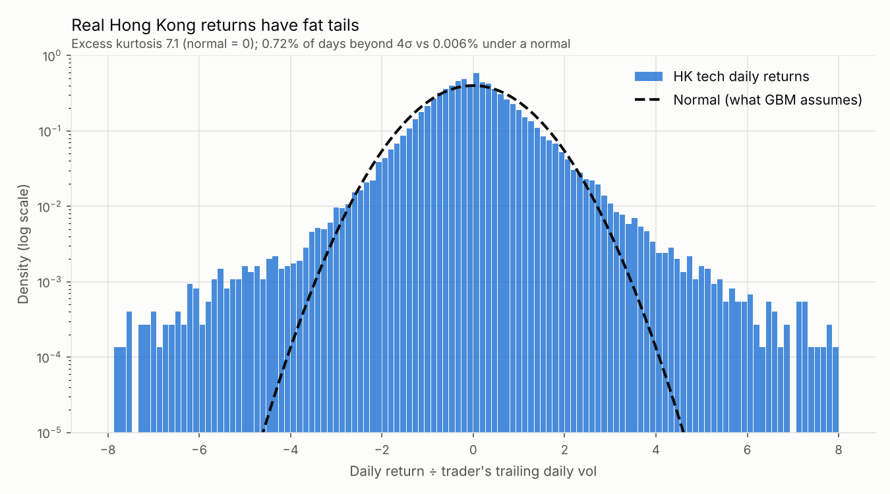
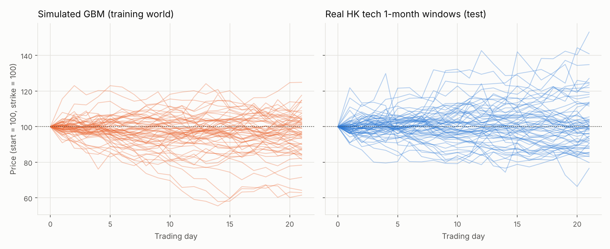
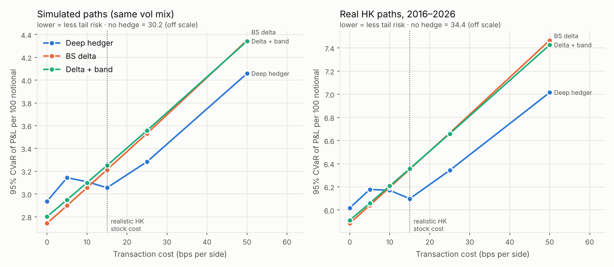

# Deep Hedging vs Delta Hedging under Transaction Costs — Simulation and Real Hong Kong Data

[](https://github.com/apiwittri2007/DeepHedging_Project/actions/workflows/ci.yml)

**Can a neural network hedge an option better than Black–Scholes delta hedging once trading costs are real — and does that survive real market data?**

1. **Simulation (Monte Carlo):** train a deep hedger to minimise the tail risk (CVaR₉₅) of a short call's hedging P&L under proportional costs, on GBM paths where Black–Scholes delta is the provably optimal zero-cost hedge.
2. **Real Hong Kong data:** take the hedger trained *only on simulation* and run it out-of-sample on **2,650 real one-month windows from 29 Hang Seng Tech stocks (2016–2026)**, against delta hedging, with month-clustered bootstrap significance tests.

Every number and chart here is produced by the code in this repo (`python -m deephedge`, `python -m deephedge.real`). NumPy + [`autograd`](https://github.com/HIPS/autograd), no deep-learning framework; 53 tests.

> **One-paragraph summary.** In simulation the deep hedger only matches delta at zero cost — it can't beat the optimal hedge — but pulls ahead as costs rise, by learning to trade less. On real HK tech stocks, tail risk is about **twice** what the GBM simulation predicts (returns have excess kurtosis ≈ 7, and hedging P&L is mostly a bet on realised vs assumed volatility, correlation 0.87). Even so, the cost advantage **survives out-of-sample**: at a realistic HK stock-trading cost of 15 bps per side, the deep hedger's CVaR₉₅ is **6.10 vs 6.35** for delta (−4%, 95% CI [−0.35, −0.14], month-clustered bootstrap), and the gap widens with cost. At 0–5 bps delta is still better — as theory says it should be.

---

## Part 1 — Simulation

**Setup.** Short one at-the-money European call (S₀ = K = 100, σ = 20%, T = 1y), hedged over 20 steps, proportional costs 0–50 bps per side. The deep hedger is a small MLP with features `[time-to-maturity, log-moneyness, current holding, BS delta]` → target holding, trained with the Rockafellar–Uryasev CVaR objective, differentiated through the whole simulated hedging path. Giving it the BS delta lets it learn a **cost-aware correction** to delta rather than relearn hedging from scratch.

| Cost (bps) | Deep hedger CVaR₉₅ | BS delta CVaR₉₅ | No hedge |
|---:|---:|---:|---:|
| 0  | **3.40** | 3.51 | 39.0 |
| 5  | **3.43** | 3.67 | 39.0 |
| 10 | **3.78** | 3.83 | 39.0 |
| 20 | 4.16 | **4.15** | 39.0 |
| 50 | **4.68** | 5.12 | 39.0 |


---

## Part 2 — Real Hong Kong data (out-of-sample)

### Data — free, real, reproducible
Daily split/dividend-adjusted closing prices of **29 Hang Seng Tech constituents** (Tencent `0700`, Alibaba `9988`, Meituan `3690`, Xiaomi `1810`, SMIC `0981`, Lenovo `0992`, …), 2000 → 2026-11-03, from Yahoo Finance via [`zjplab/US-Trading-Data`](https://github.com/zjplab/US-Trading-Data) (GPL-3.0, refreshed daily). Stored in [`data/hk/`](data/hk) with a [NOTICE](data/hk/NOTICE.md); regenerate with `scripts/fetch_hk_data.py`.

### Protocol (no look-ahead)
- **Contract:** sell a 1-month (21 trading days) ATM call on a stock; hedge daily with the stock.
- **Windows:** non-overlapping per stock → **3,727 windows**; 24 dropped for data errors.
- **Trader's volatility:** trailing 63-day realised vol, using only returns up to the window start. It sets the premium and the delta.
- **Calibration vs test:** windows before 2016 (1,077) only shape the **vol distribution** used to simulate training paths. The hedger never sees a real path. All results are on **2016–2026 (2,650 windows)**, including COVID and the 2021–22 China tech crackdown.
- **Costs:** 0–50 bps per side; **15 bps ≈ realistic** for HK stocks (stamp duty alone is 10 bps).

### 1. Real returns are not GBM


Returns scaled by the trader's own vol still have excess kurtosis ≈ 7: 0.7% of days move more than 4σ, against 0.006% under a normal. A model trained on GBM has never seen these jumps.



### 2. The cost advantage survives out-of-sample


| Cost (bps) | Deep − delta CVaR₉₅ | 95% CI (month-clustered) | Deep better? |
|---:|---:|---|---|
| 0  | +0.13 | [−0.06, +0.30] | no (delta better, not significant) |
| 5  | +0.14 | [−0.10, +0.34] | no |
| 10 | −0.03 | [−0.22, +0.14] | tie |
| **15** | **−0.25** | **[−0.35, −0.14]** | **yes, significant** |
| 25 | −0.32 | [−0.47, −0.19] | yes, significant |
| 50 | −0.45 | [−0.63, −0.27] | yes, significant |


The bootstrap resamples whole **calendar months**, not single windows. Stocks hit by the same market shock are not treated as independent evidence, so these intervals are deliberately conservative.

### 3. Why real tail risk is ~2× the simulated one


On real data, delta-hedging P&L is mostly a **bet on volatility**: sell the option with 50% vol and the stock realises 30%, and you keep the difference; get it the other way round and you lose (correlation 0.87). No hedging rule can remove this risk, which is why every hedger's CVaR roughly doubles from simulation to reality. The deep hedger's edge is the part it *can* control: trading cost.

### 4. By market regime (15 bps)


The deep hedger has lower tail risk over the whole test, the crackdown and 2023 onwards. It is worse during the COVID crash, but that's only 84 windows, so CVaR₉₅ there rests on about 4 observations.


Full tables: [`docs/real_results.md`](docs/real_results.md).

---

## Run it

```bash
python -m pip install -r requirements.txt
python -m pytest                                   # 53 tests
python -m deephedge                                # simulation study -> results/ (~30 s)
python -m deephedge.real --data data/hk            # real HK study -> results/real (~30 s)
```

## Limitations (read before quoting a number)

- **Survivorship bias:** the stock list is *today's* Hang Seng Tech members; delisted or demoted names are missing.
- **Single-stock hedging, with dividends inside adjusted prices.** A desk would often hedge with HSI/HSTECH futures, which are cheaper. Dividends are small for HK tech.
- **Vol model:** the trader uses trailing realised vol, not market implied vol (free historical HK implied vols aren't available).
- **Statistics:** one training seed per cost; CVaR₉₅ in small periods (COVID, n = 84) is noisy.
- **Data quality:** Yahoo Finance via a third-party repo; windows with any |daily log return| > 50% are dropped as errors.

## Project layout

```
deephedge/
  gbm.py              GBM paths (scalar or per-path vol) + Black-Scholes price/delta
  hedge.py            autograd-differentiable, causal hedging P&L engine
  delta.py            BS-delta / no-trade-band benchmarks
  network.py          small MLP policy
  metrics.py          CVaR, Rockafellar-Uryasev objective, paired (clustered) bootstrap
  train.py            CVaR training loop (autograd + Adam)
  experiment.py       simulation study;  __main__.py  its CLI + charts
  realdata.py         HK prices -> no-look-ahead option windows
  real_experiment.py  calibrate pre-2016, train on simulation, test on real 2016-2026
  real.py             real-data CLI + 7 charts
data/hk/              29 Hang Seng Tech stocks (Date, Close) + NOTICE
scripts/              fetch_hk_data.py
docs/                 PROJECT_SUMMARY.md, INTERVIEW.md, real_results.md, specs, plans, figures
tests/                53 tests
```
