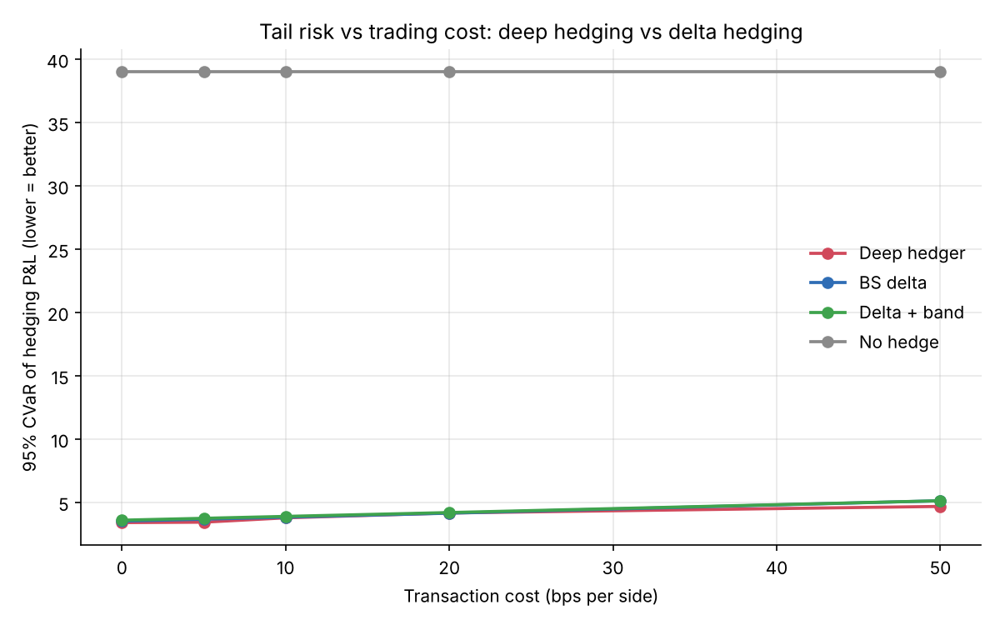
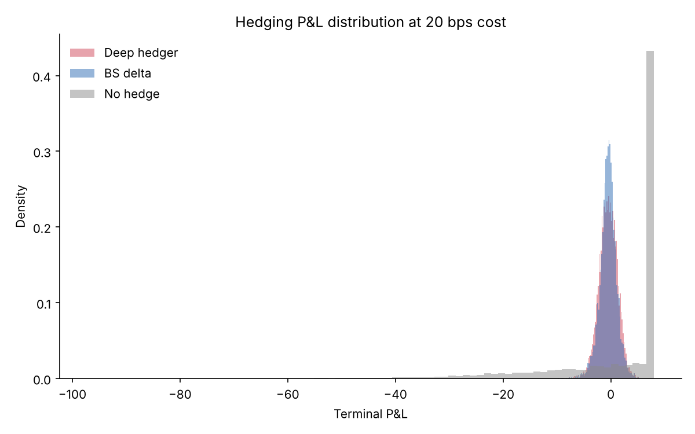
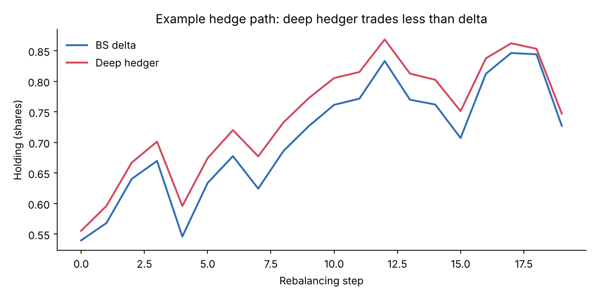

# Deep Hedging vs Delta Hedging under Transaction Costs

**Can a neural network hedge an option better than Black–Scholes delta hedging once trading costs are real?** A Monte Carlo study: simulate paths, train a deep hedger to minimise the tail risk (CVaR) of hedging P&L under proportional costs, and compare it honestly to delta hedging.

Everything is simulation, so the results below were produced by the code in this repo — run `python -m deephedge` to reproduce them. Built with NumPy + [`autograd`](https://github.com/HIPS/autograd) (reverse-mode autodiff), no deep-learning framework.

## The question

Black–Scholes delta hedging is optimal only with continuous, costless rebalancing. In reality you rebalance discretely and pay to trade, so constantly chasing the delta bleeds money. **Deep hedging** (Bühler, Gonon, Teichmann & Wood, 2019) trains a network to pick hedge positions that directly minimise a risk measure of terminal P&L — so it can learn to *trade less* when costs outweigh the risk reduction.

## Method

- **World:** simulate GBM price paths (risk-neutral), so BS delta is the provably-optimal *zero-cost* hedge — a fair, falsifiable benchmark.
- **Instrument:** short one at-the-money European call (S₀=K=100, σ=20%, T=1y), hedged over 20 steps.
- **Costs:** proportional, charged per side (0–50 bps).
- **Objective:** minimise 95% **CVaR** of terminal P&L via the Rockafellar–Uryasev formulation, trained with autograd + Adam through the full hedging path.
- **Deep hedger:** small MLP, features `[time-to-maturity, log-moneyness, current holding, BS delta]` → target holding. Feeding it the model delta lets it learn a **cost-aware correction** to delta rather than relearn hedging from scratch.
- **Benchmarks:** BS delta, delta with a no-trade band, and no hedging.

## Results (reproducible: `python -m deephedge`)

95% CVaR of hedging P&L (lower = less tail risk), 8,000 eval paths:

| Cost (bps) | Deep hedger | BS delta | No hedge |
|---:|---:|---:|---:|
| 0  | **3.40** | 3.51 | 39.0 |
| 5  | **3.43** | 3.67 | 39.0 |
| 10 | **3.78** | 3.83 | 39.0 |
| 20 | 4.16 | **4.15** | 39.0 |
| 50 | **4.68** | 5.12 | 39.0 |



**Reading it honestly:**
- At **zero cost** the deep hedger only *matches* delta — it cannot beat the optimal hedge, and it doesn't claim to.
- As **costs rise**, the gap opens in the deep hedger's favour: at 50 bps it cuts CVaR by ~9% (4.68 vs 5.12) *and* loses less on average (mean −1.08 vs −1.21), because it learns to trade less.
- Around 20 bps the two are a statistical tie — the honest "it depends" regime.
- Every strategy massively beats not hedging (CVaR ~39).




The example path shows the mechanism: the deep hedger tracks the delta but damps the small, costly adjustments.

## Run it

```bash
python -m pip install -r requirements.txt
python -m pytest            # 30 tests
python -m deephedge         # full experiment -> results/ (table + 4 plots), ~30s
python -m deephedge --quick # fast smoke run
```

## Limitations (read before quoting a number)

- **GBM world.** Real markets have jumps and stochastic vol; the clean "delta is optimal at zero cost" benchmark relies on GBM. Heston/rough-vol is the natural extension.
- **One option, one hedging instrument, European payoff.** No portfolios, no path-dependent claims yet.
- **Proportional costs only** — no fixed costs, market impact or bid-ask depth.
- **Single training seed per cost.** Results are stable but a careful study would report dispersion across seeds.
- **CVaR estimate** uses the empirical tail; with 8,000 paths the 95% tail is ~400 points.

## What's hard / what I did (interview notes)

See [`docs/INTERVIEW.md`](docs/INTERVIEW.md). In short: differentiating the CVaR of P&L through a 20-step simulated hedging path (autograd, Rockafellar–Uryasev), a causal-by-construction hedging engine, the model-delta-as-feature design, and — crucially — an **honest** result that shows exactly where the method wins and where it doesn't.

## Project layout

```
deephedge/
  gbm.py         GBM path simulation + Black-Scholes price/delta
  costs.py       proportional transaction cost
  hedge.py       autograd-differentiable hedging P&L engine (causal)
  delta.py       BS-delta and no-trade-band benchmark policies
  network.py     small MLP policy (autograd params)
  metrics.py     CVaR, Rockafellar-Uryasev objective, P&L summary
  train.py       CVaR training loop (autograd + Adam)
  experiment.py  train across cost grid vs benchmarks
  __main__.py    CLI: results table + plots
tests/           pytest suite (30 tests)
docs/            design spec, plan, interview notes, figures
```
