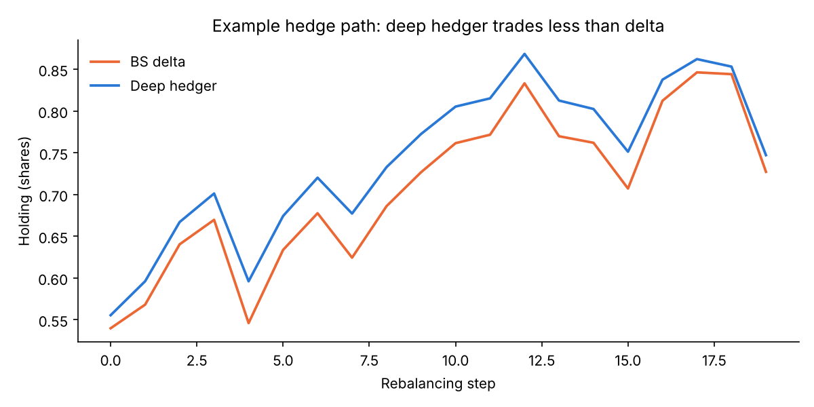
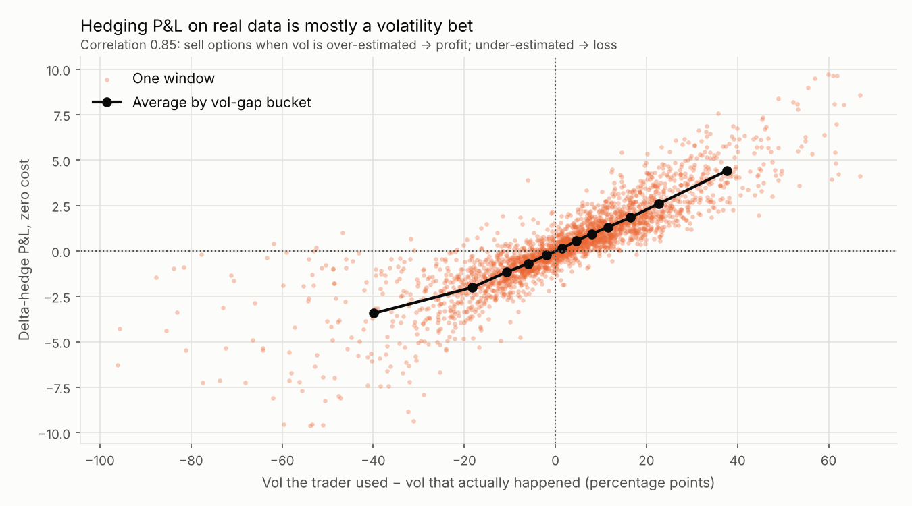
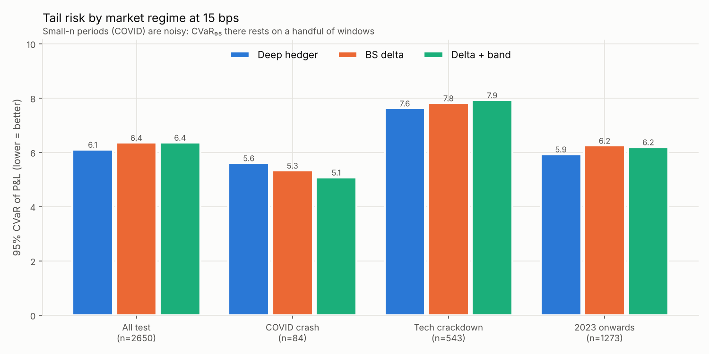
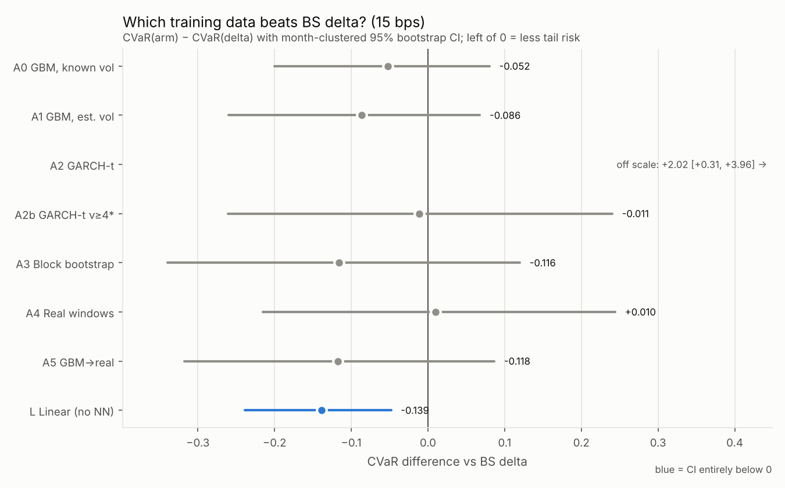
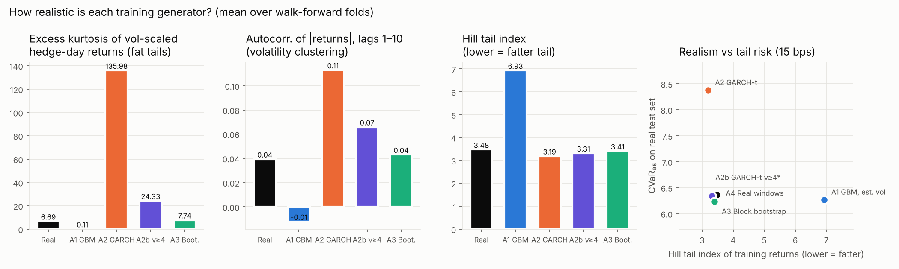

# Deep Hedging vs Delta Hedging under Transaction Costs — Simulation and Real Hong Kong Data

[](https://github.com/apiwittri2007/DeepHedging_Project/actions/workflows/ci.yml)

**Can a neural network hedge an option better than Black–Scholes delta hedging once trading costs are real — and does that survive real market data?**

1. **Simulation (Monte Carlo):** train a deep hedger to minimise the tail risk (CVaR₉₅) of a short call's hedging P&L under proportional costs, on GBM paths where Black–Scholes delta is the provably optimal zero-cost hedge.
2. **Real Hong Kong data:** take the hedger trained *only on simulation* and run it out-of-sample on **2,650 real one-month windows from 29 Hang Seng Tech stocks (2016–2026)**, against delta hedging, with month-clustered bootstrap significance tests.

Every number and chart here is produced by the code in this repo (`scripts/run_all.sh` regenerates all of it in about a minute). NumPy + [`autograd`](https://github.com/HIPS/autograd), no deep-learning framework; 54 tests.

> **One-paragraph summary.** In simulation the deep hedger only matches delta at zero cost — it can't beat the optimal hedge — but pulls ahead as costs rise, by learning to trade less. On real HK tech stocks, tail risk is about **twice** what the GBM simulation predicts (returns have excess kurtosis ≈ 7, and hedging P&L is mostly a bet on realised vs assumed volatility, correlation 0.85). Even so, the cost advantage **survives out-of-sample**: at a realistic HK stock-trading cost of 15 bps per side, the deep hedger's CVaR₉₅ is **6.10 vs 6.35** for delta (−4%, 95% CI [−0.35, −0.14], month-clustered bootstrap), and the gap widens with cost. At 0–5 bps delta is still better — as theory says it should be.

---

## Part 1 — Simulation

**Setup.** Short one at-the-money European call (S₀ = K = 100, σ = 20%, T = 1y), hedged over 20 steps, proportional costs 0–50 bps per side. The deep hedger is a small MLP with features `[time-to-maturity, log-moneyness, current holding, BS delta]` → target holding, trained with the Rockafellar–Uryasev CVaR objective, differentiated through the whole simulated hedging path. Giving it the BS delta lets it learn a **cost-aware correction** to delta rather than relearn hedging from scratch.

| Cost (bps) | Deep hedger CVaR₉₅ | BS delta CVaR₉₅ | No hedge |
|---:|---:|---:|---:|
| 0  | **3.40** | 3.51 | 39.0 |
| 5  | **3.43** | 3.67 | 39.0 |
| 10 | **3.78** | 3.83 | 39.0 |
| 20 | 4.16 | **4.15** | 39.0 |
| 50 | **4.68** | 5.12 | 39.0 |




---

## Part 2 — Real Hong Kong data (out-of-sample)

### Data — free, real, reproducible
Daily split/dividend-adjusted closing prices of **29 Hang Seng Tech constituents** (Tencent `0700`, Alibaba `9988`, Meituan `3690`, Xiaomi `1810`, SMIC `0981`, Lenovo `0992`, …), 2000 → 2026-11-03, from Yahoo Finance via [`zjplab/US-Trading-Data`](https://github.com/zjplab/US-Trading-Data) (GPL-3.0, refreshed daily). Stored in [`data/raw/hk/`](data/raw/hk) with a [NOTICE](data/raw/hk/NOTICE.md); regenerate with `scripts/fetch_hk_data.py`.

### Protocol (no look-ahead)
- **Contract:** sell a 1-month (21 trading days) ATM call on a stock; hedge daily with the stock.
- **Windows:** non-overlapping per stock → **3,727 windows**; 24 dropped for data errors.
- **Trader's volatility:** trailing 63-day realised vol, using only returns up to the window start. It sets the premium and the delta.
- **Calibration vs test:** windows before 2016 (1,077) only shape the **vol distribution** used to simulate training paths. The hedger never sees a real path. All results are on **2016–2026 (2,650 windows)**, including COVID and the 2021–22 China tech crackdown.
- **Costs:** 0–50 bps per side; **15 bps ≈ realistic** for HK stocks (stamp duty alone is 10 bps).

### 1. Real returns are not GBM


Returns scaled by the trader's own vol still have excess kurtosis ≈ 7: 0.7% of days move more than 4σ, against 0.006% under a normal. A model trained on GBM has never seen these jumps.


### 2. The cost advantage survives out-of-sample (single split, one seed — see Part 3)

> **Update (Part 3):** with walk-forward retraining and 3 seeds, the 15 bps advantage shrinks to −0.05 and is no longer significant; it remains significant at 50 bps.


| Cost (bps) | Deep − delta CVaR₉₅ | 95% CI (month-clustered) | Deep better? |
|---:|---:|---|---|
| 0  | +0.13 | [−0.06, +0.30] | no (delta better, not significant) |
| 5  | +0.14 | [−0.10, +0.34] | no |
| 10 | −0.03 | [−0.22, +0.14] | tie |
| **15** | **−0.25** | **[−0.35, −0.14]** | **yes, significant** |
| 25 | −0.32 | [−0.47, −0.19] | yes, significant |
| 50 | −0.45 | [−0.63, −0.27] | yes, significant |


The bootstrap resamples whole **calendar months**, not single windows. Stocks hit by the same market shock are not treated as independent evidence, so these intervals are deliberately conservative.

### 3. Why real tail risk is ~2× the simulated one


On real data, delta-hedging P&L is mostly a **bet on volatility**: sell the option with 50% vol and the stock realises 30%, and you keep the difference; get it the other way round and you lose (correlation 0.85). No hedging rule can remove this risk, which is why every hedger's CVaR roughly doubles from simulation to reality. The deep hedger's edge is the part it *can* control: trading cost.

### 4. By market regime (15 bps)


The deep hedger has lower tail risk over the whole test, the crackdown and 2023 onwards. It is worse during the COVID crash, but that's only 84 windows, so CVaR₉₅ there rests on about 4 observations.


Full tables: [`results/real/real_summary.md`](results/real/real_summary.md) · simulation: [`results/sim/summary.md`](results/sim/summary.md).

---

## Part 3 — Which training data makes a better hedger? (walk-forward, 3 seeds)

Pre-registered design: [`docs/superpowers/specs/2026-11-15-training-data-study-design.md`](docs/superpowers/specs/2026-11-15-training-data-study-design.md).
Same 2,650 real test windows (2016–2026), but now **walk-forward**: for each test year, every model may only use prices dated before 1 January of that year. 6 training arms × 6 costs × 3 seeds × 11 years = 990 training jobs (~40 min on 2 CPUs), plus one sensitivity arm.

| Arm | Training data |
|---|---|
| A0 | GBM, trader knows the true vol (the Part 2 method) |
| A1 | GBM, trader *estimates* vol from 63 warm-up days, as on real data |
| A2 | GARCH(1,1) with Student-t shocks, fitted per stock |
| A2b | *Sensitivity, added after the main run:* A2 with Student-t ν ≥ 4 (finite tail kurtosis) |
| A3 | Stationary block bootstrap of each stock's real returns |
| A4 | Real overlapping windows only |
| A5 | A1, then fine-tuned on A4 |
| L | **No neural net:** delta + a + b·δ + c·δ², fitted by least squares on real windows |




**Results at 15 bps (primary cost; CVaR difference vs BS delta, month-clustered 95% CI):**

| Arm | vs delta | 95% CI | vs A1 |
|---|---:|---|---:|
| A0 GBM, known vol | −0.05 | [−0.20, +0.08] | +0.03 |
| A1 GBM, est. vol | −0.09 | [−0.26, +0.07] | — |
| A2 GARCH-t | +2.02 | [+0.31, +3.96] | +2.11 (worse) |
| A2b GARCH-t, ν ≥ 4* | −0.01 | [−0.26, +0.24] | +0.08 |
| A3 Block bootstrap | −0.12 | [−0.34, +0.12] | −0.03 |
| A4 Real windows | +0.01 | [−0.22, +0.24] | +0.10 |
| A5 GBM → real | −0.12 | [−0.32, +0.09] | −0.03 |
| **L Linear (no NN)** | **−0.14** | **[−0.24, −0.05]** | −0.05 |

What this says, plainly:
1. **Under walk-forward retraining with 3 seeds, no deep arm significantly beats BS delta at 15 bps.** The Part 2 result (−0.25, significant) came from a single split and a single seed; here seed-to-seed spread (sd 0.03–0.11) is as large as the effect. Part 2's 15 bps claim should be read as *not robust*.
2. **The simple linear correction L is the only method that beats delta significantly at 0–25 bps**, echoing Ruf & Wang (2022): a regression on delta matches or beats the network.
3. **H3 (gain grows with cost) holds:** at 50 bps A0, A1 and A5 beat delta significantly (−0.27, −0.31, −0.38).
4. **More realistic training data did not help (H1 not supported).** The block bootstrap is the most realistic generator (below) and among the best arms, but not significantly better than plain GBM. Training on real windows alone (A4) is no better than delta, even in later years with 3× more data.
5. **GARCH-t training is unstable:** fitted to pre-year data it produces far fatter tails than reality (kurtosis 136 vs 6.7), and some seeds blow up (2022 especially). The sensitivity arm A2b (ν ≥ 4, kurtosis 24) trains stably but only ties delta (−0.01), so a better GARCH does not change the conclusion.

\* A2b was added after seeing the main results. Its only justification is the pre-year realism check, so treat it as a sensitivity check, not a pre-registered arm.





Full tables: [`results/training_data/summary.md`](results/training_data/summary.md).

## Run it

```bash
python -m pip install -e ".[dev]"
bash scripts/run_all.sh          # tests + both studies -> results/ and figures/ (~1 min)

# or one study at a time, settings in configs/
python -m deephedge.experiments.run_sim  --config configs/sim.json
python -m deephedge.experiments.run_real --config configs/real.json
```

## Limitations (read before quoting a number)

- **Survivorship bias:** the stock list is *today's* Hang Seng Tech members; delisted or demoted names are missing.
- **Single-stock hedging, with dividends inside adjusted prices.** A desk would often hedge with HSI/HSTECH futures, which are cheaper. Dividends are small for HK tech.
- **Vol model:** the trader uses trailing realised vol, not market implied vol (free historical HK implied vols aren't available).
- **Statistics:** one training seed per cost; CVaR₉₅ in small periods (COVID, n = 84) is noisy.
- **Data quality:** Yahoo Finance via a third-party repo; windows with any |daily log return| > 50% are dropped as errors.

## Project layout

```
DeepHedging_Project/
├── src/deephedge/
│   ├── sim/            gbm.py — GBM + Black–Scholes; generators.py — GBM warm-up, GARCH-t, block bootstrap
│   ├── hedging/        hedge.py (causal, differentiable P&L engine), delta.py, costs.py, metrics.py
│   ├── models/         network.py (MLP), train.py (CVaR training, fine-tuning), linear.py (regression benchmark)
│   ├── data/           realdata.py — HK prices -> no-look-ahead option windows
│   ├── experiments/    sim_study, real_study, training_data_study + run_sim/run_real/run_training_data CLIs
│   └── plots/          sim_charts.py, real_charts.py, training_data_charts.py
├── data/raw/hk/        29 Hang Seng Tech stocks (Date, Close) + licence NOTICE
├── configs/            sim.json, real.json, training_data.json — settings for each study
├── scripts/            run_all.sh (reproduce everything), fetch_hk_data.py
├── results/            sim/, real/, training_data/ — tables
├── figures/            sim/, real/, training_data/ — every chart in this README
├── paper/              outline + references for the research paper
├── docs/               PROJECT_SUMMARY.md, INTERVIEW.md, design specs and plans
└── tests/              74 tests
```
