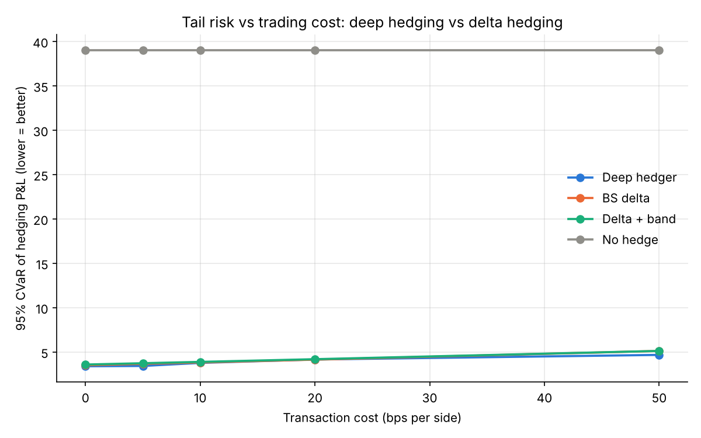
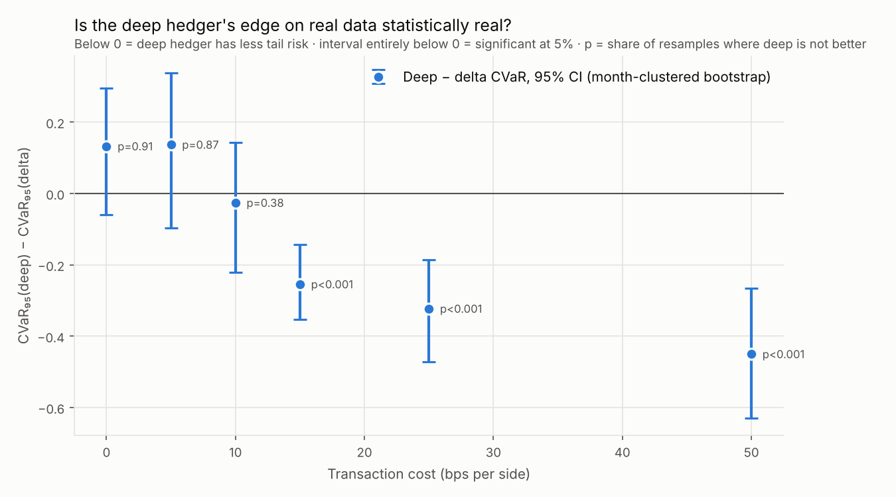
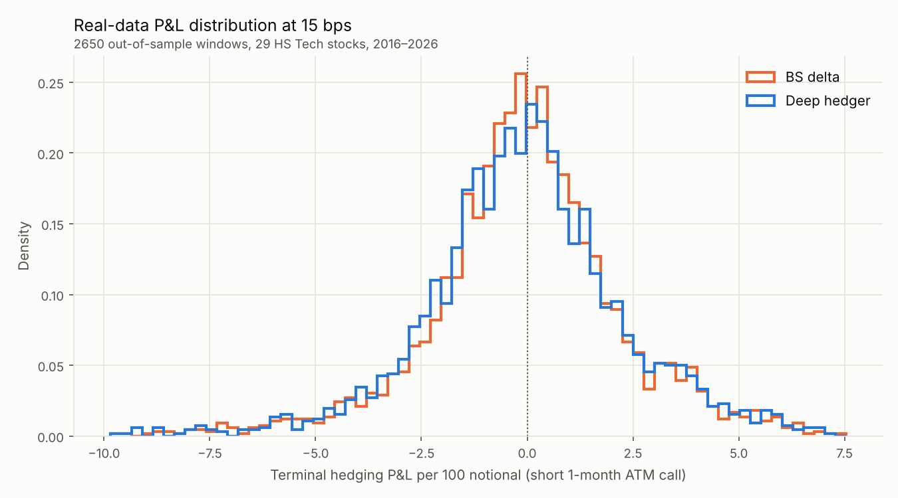
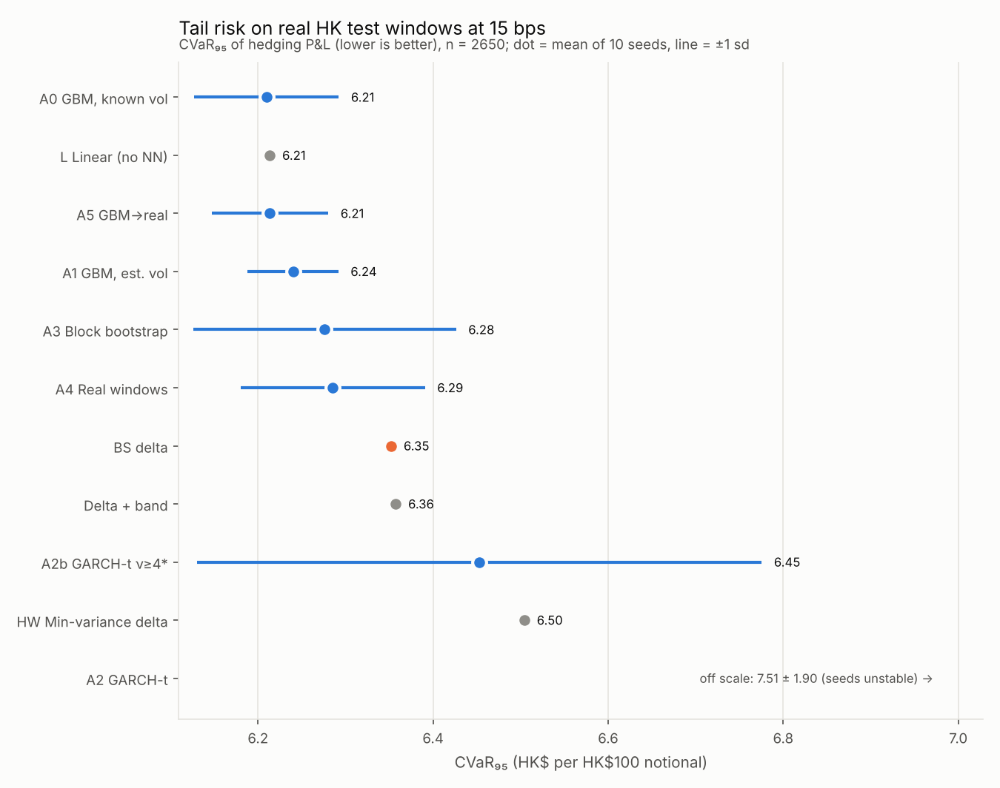
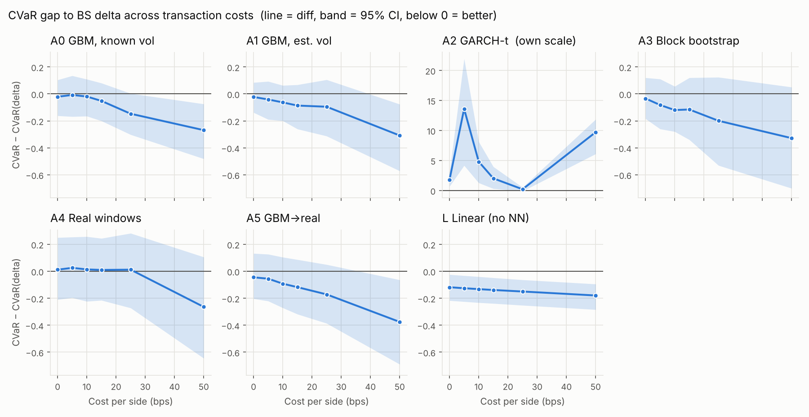
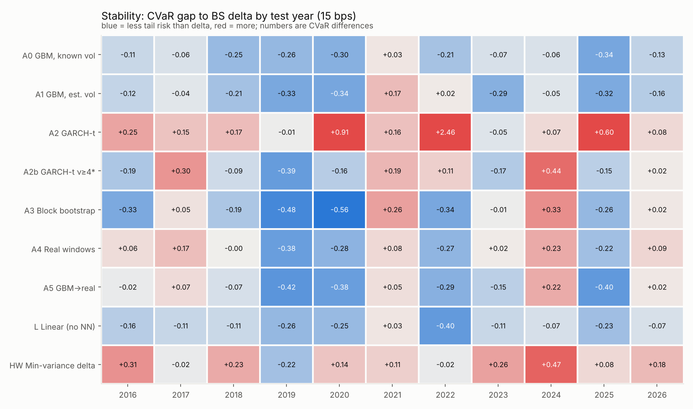
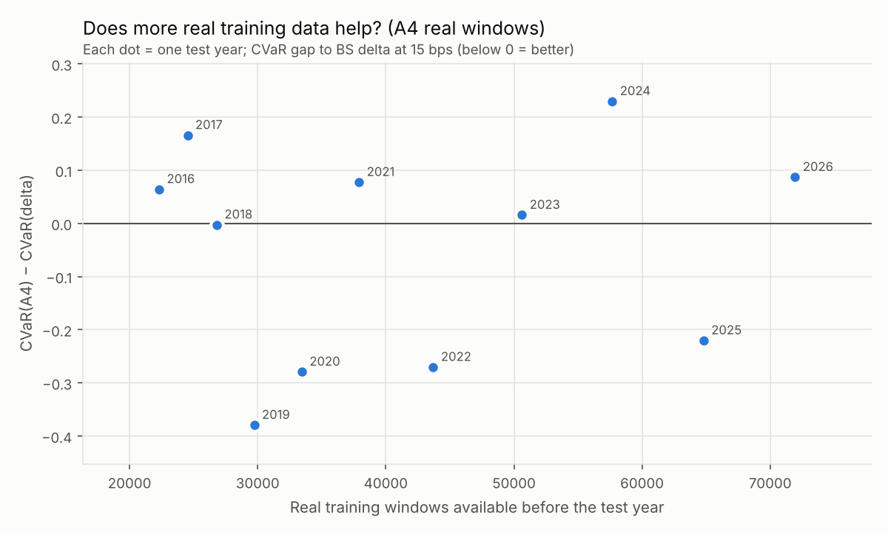

# Does Deep Hedging Survive an Honest Evaluation? — Real Hong Kong Stocks, Transaction Costs, Walk-Forward Tests

[](https://github.com/apiwittri2007/DeepHedging_Project/actions/workflows/ci.yml)
[](https://colab.research.google.com/github/apiwittri2007/DeepHedging_Project/blob/main/notebooks/quickstart.ipynb)
[](paper/main.pdf)
[](LICENSE)

**Can a neural network hedge an option better than Black–Scholes delta once trading costs are real — and which training data makes it better?**

> **Headline (walk-forward 2016–2026, 2,650 real one-month option windows on 29 Hang Seng Tech stocks, 10 seeds, month-clustered bootstrap, Romano–Wolf correction over 60 tests):**
> - At a **realistic HK cost of 15 bps**, a **3-parameter linear correction to delta** is the only method significant after correction: CVaR₉₅ −0.14 [−0.23, −0.04], adjusted p = 0.03 — about **HK$1,400 less tail loss per HK$1m notional** (2.3% of the premium). This is **borderline**: with quarterly instead of monthly bootstrap clusters p = 0.06 (at 25–50 bps it holds under every cluster choice). The best deep hedgers reach the same point estimate but are **not significant**.
> - At **50 bps**, deep hedgers pay off: −0.30 to −0.37 (5–6% of the premium), 1.7–2× the linear correction.
> - A deep-hedger gain that looked significant on **one split with one seed** (−0.25, Part 2) does **not** hold up under yearly retraining and multiple seeds. **More realistic training data** (GARCH, block bootstrap, real windows) **does not help.**
> - In one line: *the evaluation protocol and the cost level matter more than the training data.*


Everything here is produced by code in this repo. NumPy + [`autograd`](https://github.com/HIPS/autograd), no deep-learning framework; 87 tests; pinned environment in `requirements-lock.txt`. Quick look without training: the [Colab notebook](notebooks/quickstart.ipynb) (~10 s). Full replication: `scripts/run_all.sh` (~3.5 h on 2 CPUs; see [Replication](#run-it)).

The project has three parts: a GBM simulation (Part 1), a single-split pilot on real data (Part 2, superseded) and the main walk-forward study (Part 3). A paper draft is in [`paper/main.pdf`](paper/main.pdf).

---

## Part 1 — Simulation

**Setup.** Short one at-the-money European call (S₀ = K = 100, σ = 20%, T = 1y), hedged over 20 steps, proportional costs 0–50 bps per side. The deep hedger is a small MLP with features `[time-to-maturity, log-moneyness, current holding, BS delta]` → target holding, trained with the Rockafellar–Uryasev CVaR objective, differentiated through the whole simulated hedging path. Giving it the BS delta lets it learn a **cost-aware correction** to delta rather than relearn hedging from scratch.

| Cost (bps) | Deep hedger CVaR₉₅ | BS delta CVaR₉₅ | No hedge |
|---:|---:|---:|---:|
| 0  | **3.40** | 3.51 | 39.0 |
| 5  | **3.43** | 3.67 | 39.0 |
| 10 | **3.78** | 3.83 | 39.0 |
| 20 | 4.16 | **4.15** | 39.0 |
| 50 | **4.68** | 5.12 | 39.0 |




---

## Part 2 — Pilot on real Hong Kong data (single split, one seed — superseded by Part 3)

### Data — free, real, reproducible
Daily split/dividend-adjusted closing prices of **29 Hang Seng Tech constituents** (Tencent `0700`, Alibaba `9988`, Meituan `3690`, Xiaomi `1810`, SMIC `0981`, Lenovo `0992`, …), 2000 → 2026-11-03, from Yahoo Finance via [`zjplab/US-Trading-Data`](https://github.com/zjplab/US-Trading-Data) (GPL-3.0, refreshed daily). Stored in [`data/raw/hk/`](data/raw/hk) with a [NOTICE](data/raw/hk/NOTICE.md); regenerate with `scripts/fetch_hk_data.py`.

### Protocol (no look-ahead)
- **Contract:** sell a 1-month (21 trading days) ATM call on a stock; hedge daily with the stock.
- **Windows:** non-overlapping per stock → **3,727 windows**; 24 dropped for data errors.
- **Trader's volatility:** trailing 63-day realised vol, using only returns up to the window start. It sets the premium and the delta.
- **Calibration vs test:** windows before 2016 (1,077) only shape the **vol distribution** used to simulate training paths. The hedger never sees a real path. All results are on **2016–2026 (2,650 windows)**, including COVID and the 2021–22 China tech crackdown.
- **Costs:** 0–50 bps per side; **15 bps ≈ realistic** for HK stocks (stamp duty alone is 10 bps).

### 1. Real returns are not GBM


Returns scaled by the trader's own vol still have excess kurtosis ≈ 7: 0.7% of days move more than 4σ, against 0.006% under a normal. A model trained on GBM has never seen these jumps.


### 2. Pilot result: deep vs delta on one split (not robust — see Part 3)

> **Superseded.** This pilot trained one hedger once (one seed) on pre-2016 data. Under walk-forward retraining with 10 seeds and a multiple-testing correction, the 15 bps gain below is **not significant** (Part 3). It is kept to show how much the protocol matters.


| Cost (bps) | Deep − delta CVaR₉₅ | 95% CI (month-clustered) | Deep better? |
|---:|---:|---|---|
| 0  | +0.13 | [−0.06, +0.30] | no (delta better, not significant) |
| 5  | +0.14 | [−0.10, +0.34] | no |
| 10 | −0.03 | [−0.22, +0.14] | tie |
| **15** | **−0.25** | **[−0.35, −0.14]** | **yes, significant** |
| 25 | −0.32 | [−0.47, −0.19] | yes, significant |
| 50 | −0.45 | [−0.63, −0.27] | yes, significant |



The bootstrap resamples whole **calendar months**, not single windows. Stocks hit by the same market shock are not treated as independent evidence, so these intervals are deliberately conservative.

### 3. Why real tail risk is ~2× the simulated one


On real data, delta-hedging P&L is mostly a **bet on volatility**: sell the option with 50% vol and the stock realises 30%, and you keep the difference; get it the other way round and you lose (correlation 0.85). No hedging rule can remove this risk, which is why every hedger's CVaR roughly doubles from simulation to reality. The deep hedger's edge is the part it *can* control: trading cost.

### 4. By market regime (15 bps)


The deep hedger has lower tail risk over the whole test, the crackdown and 2023 onwards. It is worse during the COVID crash, but that's only 84 windows, so CVaR₉₅ there rests on about 4 observations.



Full tables: [`results/real/real_summary.md`](results/real/real_summary.md) · simulation: [`results/sim/summary.md`](results/sim/summary.md).

---

## Part 3 — Which training data makes a better hedger? (walk-forward, 10 seeds, multiple-testing corrected)

Pre-registered design: [`docs/design/specs/2026-11-15-training-data-study-design.md`](docs/design/specs/2026-11-15-training-data-study-design.md); robustness additions: [`2026-11-17-plan-b-robustness-design.md`](docs/design/specs/2026-11-17-plan-b-robustness-design.md).
Same 2,650 real test windows (2016–2026), now **walk-forward**: for each test year, every model may only use prices dated before 1 January of that year. 6 training jobs per year × cost × seed (A5 is fine-tuned inside the A1 job) × 6 costs × 10 seeds × 11 years = 3,960 jobs, 4,620 trained networks (~3.1 h on 2 CPUs). Seeds 0–2 reproduce the earlier 3-seed run exactly.

| Arm | Training data / rule |
|---|---|
| A0 | GBM, trader knows the true vol (the Part 2 method) |
| A1 | GBM, trader *estimates* vol from 63 warm-up days, as on real data |
| A2 | GARCH(1,1) with Student-t shocks, fitted per stock |
| A2b | *Post hoc sensitivity:* A2 with Student-t ν ≥ 4 (finite tail kurtosis) |
| A3 | Stationary block bootstrap of each stock's real returns |
| A4 | Real overlapping windows only |
| A5 | A1, then fine-tuned on A4 |
| L | **No neural net:** δ + a + b·δ + c·δ², least squares on real pre-year windows |
| HW | **No neural net:** Hull & White (2017) minimum-variance form δ + n(d₁)(a + b·δ + c·δ²), fitted the same way |



**CVaR difference vs BS delta** (negative = less tail risk; month-clustered 95% CI; p(RW) = Romano–Wolf step-down adjusted over all 60 arm × cost tests):

| Arm | 15 bps | 95% CI | p(RW) | 50 bps | 95% CI | p(RW) |
|---|---:|---|---:|---:|---|---:|
| A0 GBM, known vol | −0.14 | [−0.26, −0.01] | 0.14 | **−0.31** | [−0.51, −0.09] | **0.03** |
| A1 GBM, est. vol | −0.11 | [−0.24, +0.03] | 0.37 | −0.30 | [−0.52, −0.07] | 0.06 |
| A2 GARCH-t | +1.16 | [+0.51, +1.76] | 1.00 | +3.12 | [+2.41, +4.23] | 1.00 |
| A2b GARCH-t, ν ≥ 4* | +0.10 | [−0.14, +0.33] | 1.00 | −0.06 | [−0.47, +0.34] | 0.93 |
| A3 Block bootstrap | −0.08 | [−0.41, +0.23] | 0.89 | −0.24 | [−0.74, +0.24] | 0.73 |
| A4 Real windows | −0.07 | [−0.28, +0.12] | 0.84 | −0.25 | [−0.64, +0.14] | 0.58 |
| A5 GBM → real | −0.14 | [−0.32, +0.03] | 0.41 | −0.37 | [−0.67, −0.07] | 0.09 |
| **L Linear (no NN)** | **−0.14** | **[−0.23, −0.04]** | **0.03** | **−0.18** | [−0.26, −0.08] | **0.004** |
| HW Min-variance delta | +0.15 | [+0.06, +0.26] | 1.00 | +0.17 | [+0.07, +0.28] | 1.00 |

**Economic size at 15 bps:** L cuts tail loss by about **HK$1,400 per HK$1m notional (2.3% of the average premium of HK$6.05 per HK$100)** and raises mean P&L by ~HK$240. At 50 bps the best deep arm (A5) cuts ~HK$3,700 (6.1% of premium). Full table: [`results/training_data/economic_size.csv`](results/training_data/economic_size.csv).

What this says, plainly:
1. **Protocol fragility.** The pilot's significant −0.25 at 15 bps came from one split and one seed. With yearly retraining it is −0.05 using 3 seeds and −0.14 using 10. Seed-to-seed spread (sd 0.05–0.15) is the same size as the effect, and after correcting for 60 tests it is not significant.
2. **At realistic costs a 3-parameter correction is enough.** L is the only method significant after correction at 10, 15 and 25 bps, and it beats delta in 10 of 11 test years — in line with Ruf & Wang (2022), whose linear regression on Black–Scholes sensitivities matched neural networks. At 10–15 bps the significance depends on the bootstrap cluster (month vs quarter, table below); at 25–50 bps it does not.
3. **Deep hedging pays when trading is expensive.** At 50 bps deep arms cut tail risk 1.7–2× as much as L; A0 is significant after correction, A1 and A5 are borderline.
4. **Realistic training data does not help.** The block bootstrap matches real tails and volatility clustering best (below), yet trains no better a hedger than plain GBM — consistent with Hashimoto et al. (2026). GARCH-t overshoots the tails (kurtosis 136 vs 6.7) and makes training unstable; the post hoc ν ≥ 4 version is stable but still no better than delta.
5. **Hull–White form hurts here.** Fitted to P&L variance on synthetic option prices it *raises* CVaR — without traded options there is no spot–implied-vol co-movement for it to capture. This is a limitation of synthetic prices, not evidence against Hull–White.

\* A2b was added after seeing the main results, motivated only by the pre-year realism check.

**Robustness of the corrected p-values to the bootstrap cluster** (a 21-day window can span two months; 1 month is the pre-registered choice; Romano–Wolf p):

| | L 10 bps | L 15 bps | L 25 bps | L 50 bps | A0 50 bps | A1 50 bps |
|---|---:|---:|---:|---:|---:|---:|
| 1-month clusters | 0.049 | **0.033** | 0.018 | 0.004 | 0.034 | 0.063 |
| 2-month clusters | 0.024 | 0.017 | 0.010 | 0.004 | 0.053 | 0.061 |
| 3-month clusters | 0.091 | 0.064 | 0.042 | 0.017 | 0.042 | 0.049 |

No comparison survives the more conservative Holm correction at 5% (smallest: L at 50 bps, p = 0.06). Inference is conditional on the 10 trained networks.






Full tables: [`results/training_data/summary.md`](results/training_data/summary.md) · per-window P&L for every arm, cost and seed: [`pnl_by_window.csv.gz`](results/training_data/pnl_by_window.csv.gz).

## Run it

```bash
python -m pip install -r requirements-lock.txt && python -m pip install -e . --no-deps
bash scripts/run_all.sh          # tests + all three studies -> results/ and figures/ (~3.5 h on 2 CPUs)
python scripts/make_paper_assets.py && (cd paper && latexmk -pdf main.tex)   # paper tables + PDF

# or one study at a time, settings in configs/
python -m deephedge.experiments.run_sim  --config configs/sim.json
python -m deephedge.experiments.run_real --config configs/real.json
python -m deephedge.experiments.run_training_data --config configs/training_data.json   # Part 3
python -m deephedge.experiments.run_training_data --from-results                        # redraw tables/charts only
```

## Limitations (read before quoting a number)

- **Survivorship bias:** the stock list is *today's* Hang Seng Tech members; delisted or demoted names are missing.
- **Single-stock hedging, with dividends inside adjusted prices.** A desk would often hedge with HSI/HSTECH futures, which are cheaper. Dividends are small for HK tech.
- **Synthetic option prices:** options are priced with the trader's trailing realised vol, not traded quotes (free historical HK option prices aren't available). This is the main limitation; a replication on traded options is the next step.
- **Statistics:** Part 3 uses 10 seeds and corrects for 60 tests; the 15 bps result is borderline across cluster choices, and p-values are conditional on the trained seeds. Part 2 (pilot) used one seed. CVaR₉₅ in small periods (COVID, n = 84) is noisy.
- **Total-return prices:** prices are dividend-adjusted, so the option is effectively on a total-return series.
- **Data quality:** Yahoo Finance via a third-party repo; windows with any |daily log return| > 50% are dropped as errors.

## Project layout

```
DeepHedging_Project/
├── src/deephedge/
│   ├── sim/            gbm.py — GBM + Black–Scholes; generators.py — GBM warm-up, GARCH-t, block bootstrap
│   ├── hedging/        hedge.py (causal, differentiable P&L engine), delta.py, costs.py, metrics.py
│   ├── models/         network.py (MLP), train.py (CVaR training, fine-tuning), linear.py (L and Hull–White benchmarks)
│   ├── data/           realdata.py — HK prices -> no-look-ahead option windows
│   ├── experiments/    sim_study, real_study, training_data_study, inference (Holm, Romano–Wolf) + CLIs
│   └── plots/          sim_charts.py, real_charts.py, training_data_charts.py
├── data/raw/hk/        29 Hang Seng Tech stocks (Date, Close) + licence NOTICE
├── configs/            sim.json, real.json, training_data.json — settings for each study
├── scripts/            run_all.sh (reproduce everything), make_paper_assets.py, fetch_hk_data.py
├── results/            sim/, real/, training_data/ — tables
├── figures/            sim/, real/, training_data/ — every chart in this README
├── paper/              main.tex + main.pdf (draft), generated tables, references.bib, outline
├── notebooks/          quickstart.ipynb — headline results in ~10 s (Colab)
├── docs/               PROJECT_SUMMARY.md, INTERVIEW.md, design specs and plans
└── tests/              87 tests
```
